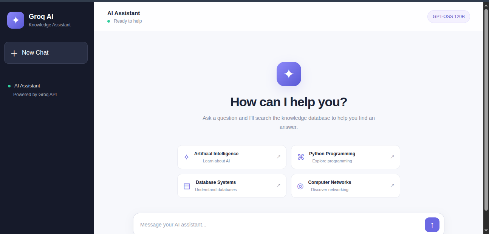

🤖 Groq RAG Knowledge Assistant

<strong>Your AI-powered knowledge assistant, built with Flask, Groq API, and Retrieval-Augmented Generation.</strong>

🌐 Live Chatbot Preview

<em>Click the screenshot to open and use the live chatbot.</em>

✨ About the Project

Groq RAG Knowledge Assistant is a web-based AI chatbot that retrieves relevant information from a local knowledge database and generates context-aware responses using a large language model.

🚀 Features
💬 Interactive chat interface
🧠 Retrieval-Augmented Generation (RAG)
🔎 TF-IDF and cosine similarity search
⚡ Groq API integration
🌊 Streaming AI responses
📚 Custom knowledge base using database.json
📱 Web-based interface
☁️ Live deployment on Render
🛠️ Built With

🎯 Try It Yourself

Ready to explore the chatbot?

<a href="https://groq-rag-chatbot-kvtt.onrender.com">
<strong>👉 Launch Groq RAG Knowledge Assistant</strong>
</a>

Note: The first request may take longer if the hosting service has been idle.
📖 Project Documentation

Want to understand the code, install the project locally, or deploy your own version?

➡️ Read the Complete Project Guide

👨‍💻 Author

Majharul

GitHub: @MrMajharul
Repository: groq-rag-chatbot
Live Demo: Open Chatbot

Built with Python, Flask, Groq API, and ❤️

